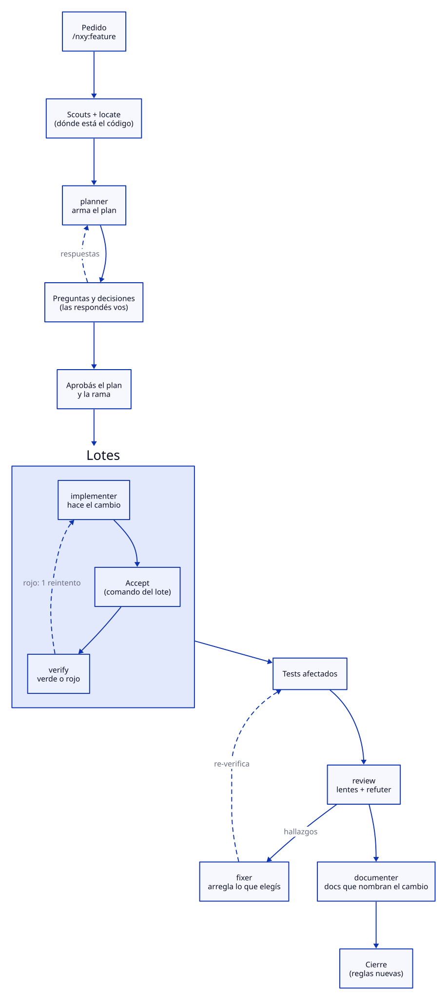
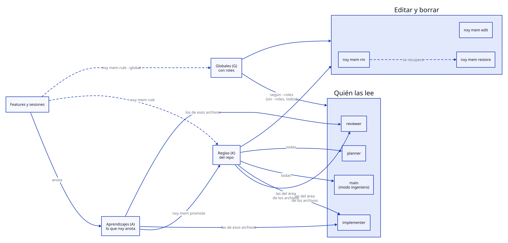
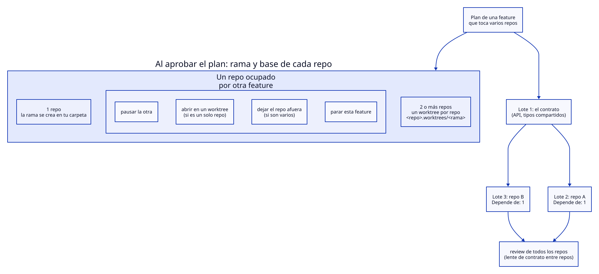
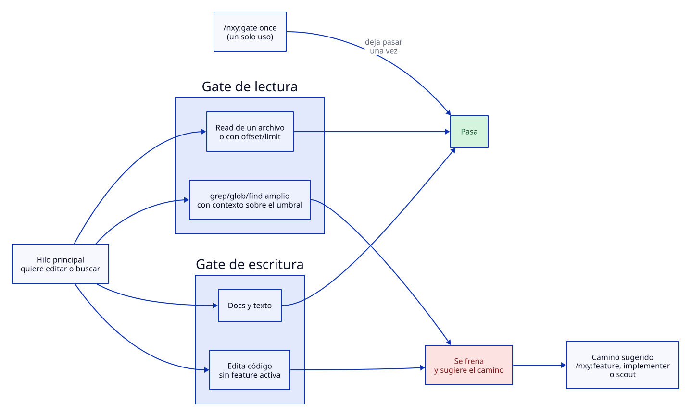

<p align="center">
  
</p>

<p align="center">Plugin de Claude Code para gastar menos tokens sin perder calidad, y para ver en qué se va cada dólar.</p>

nxy es un plugin de Claude Code con un solo binario escrito en Go: no necesitás Node ni nada más.
Convierte tus pedidos en features con plan, lotes verificados y review; recorta lo que Claude lee; guarda las reglas de tu repo y te muestra lo que gastás.
Funciona con cualquier lenguaje, en Windows, Linux y macOS, y tiene una consola (la TUI) para verlo todo en otra terminal.

<!-- video demo: reemplazá esta línea por la URL de user-attachments de docs/assets/video/out/demo.mp4 -->

## Una feature, de punta a punta

`/nxy:feature <pedido>` te lleva del pedido a un plan que aprobás vos, lotes que nxy verifica con un test, una review y los arreglos que elijas. Vos decidís; el resto lo hacen agentes con el contexto justo.



[Docs → Una feature, paso a paso](docs/feature.md)

## Plan y lotes

Antes de tocar código ves el plan: qué se hace, qué preguntas quedaron y en cuántos lotes. Cada lote termina con un comando de aceptación (`Accept:`) que corre nxy: verde sigue, rojo se arregla antes de seguir.


[Docs → Plan y lotes](docs/plan-y-lotes.md)

## Review

Cuando los lotes están en verde, nxy revisa lo que cambió, te muestra los hallazgos y vos elegís cuáles se arreglan antes del PR.

[Docs → Review](docs/review.md)

## Memoria

Las reglas de tu repo, tus reglas globales y lo que nxy va aprendiendo quedan en una base local, y sólo les llegan a los agentes que las necesitan. Sobreviven al `/clear`.



[Docs → Memoria](docs/memoria.md)

## La TUI y decidir desde ahí

Una consola que abrís en otra terminal, al lado de Claude Code: tus features, el plan, los agentes, la memoria, el gasto y la config, en vivo. Cuando Claude te hace una pregunta de nxy, la contestás ahí.


[Docs → La TUI](docs/tui.md) · [Docs → Decidir desde la TUI](docs/decidir.md)

## Modo ingeniero

Para los cambios donde querés decidir el diseño vos, bifurcación por bifurcación, antes de que nadie planifique ni toque código.


[Docs → Modo ingeniero](docs/ingeniero.md)

## Varios repos y worktrees

Un cambio que toca la API y el front es una sola feature, con un plan y una review. Y varias features pueden convivir en un mismo repo, cada una en su carpeta, sin pisarse.



[Docs → Varios repos y worktrees](docs/varios-repos.md)

## Buscar sin leer medio repo

`/nxy:locate` encuentra dónde vive algo y te devuelve un `path:line`, sin llenar tu contexto de archivos.


[Docs → Buscar](docs/buscar.md)

## Ver en qué se gasta

La statusline, `/nxy:stats`, `/nxy:trend` y la pantalla Gasto de la TUI te muestran cuánto cuesta cada sesión, por qué, y cuándo conviene cortar. Los números salen del `usage` real de Claude Code, no de estimaciones.


[Docs → Ver en qué se gasta](docs/gasto.md)

## El freno (gate)

Dos frenos que cuidan el contexto del hilo principal: uno para escribir código sin una feature y otro para las búsquedas amplias con la sesión ya cargada. Frenan con un mensaje que le dice a Claude qué hacer; casi nunca te toca actuar.



[Docs → El freno](docs/gate.md)

## El filtro de comandos (rtk)

Los comandos de consola de Claude pasan por [rtk](https://github.com/rtk-ai/rtk), que recorta la salida a lo que sirve: unos cientos de caracteres en vez de miles. Si no tenés rtk, los comandos pasan enteros y nada se rompe.

[Docs → El filtro](docs/rtk.md)

## Instalación rápida

En Claude Code:

```
/plugin marketplace add mananos/nxy.dev
/plugin install nxy@nxy-dev
/nxy:statusline install
```

La primera vez que corre un hook, nxy baja su binario (sólo hace falta `curl`). `/nxy:setup` te dice qué herramientas opcionales (rtk, rg, codegraph, d2) te suman ahorro y te muestra el comando exacto; no instala nada sin que le digas que sí. Para abrir la TUI: `/nxy:tui`.

Todo el detalle, y qué hacer si algo no arranca: [Instalación](docs/instalacion.md).

## Documentación

| Página | De qué trata |
| --- | --- |
| [Instalación](docs/instalacion.md) | Requisitos, plugin, statusline, TUI y qué hacer si algo no arranca |
| [Primer uso](docs/primer-uso.md) | Qué hace nxy solo, qué te pregunta al principio y qué probar primero |
| [Una feature](docs/feature.md) | `/nxy:feature` paso a paso, según el tamaño del cambio |
| [Plan y lotes](docs/plan-y-lotes.md) | Qué trae el plan, cómo se verifica cada lote y qué hacer con un rojo |
| [Review](docs/review.md) | Hallazgos, lentes y qué se arregla antes del PR |
| [Memoria](docs/memoria.md) | Reglas, aprendizajes y globales: ver, editar, exportar |
| [La TUI](docs/tui.md) | Pantallas y teclas de la consola de control |
| [Decidir desde la TUI](docs/decidir.md) | Contestar las preguntas de nxy sin volver a Claude Code |
| [Modo ingeniero](docs/ingeniero.md) | Decidir el diseño vos antes de planificar |
| [Varios repos](docs/varios-repos.md) | Planes que tocan varios repos y features en worktrees |
| [Buscar](docs/buscar.md) | `/nxy:locate` y los scouts |
| [Gasto](docs/gasto.md) | Statusline, stats, tendencia y cuándo cortar una sesión |
| [El freno](docs/gate.md) | Los dos frenos del hilo principal y cómo levantarlos |
| [El filtro (rtk)](docs/rtk.md) | Cómo se recorta la salida de los comandos |
| [Mensajes](docs/mensajes.md) | Cada mensaje de nxy, qué significa y qué hacer |
| [Configuración](docs/configuracion.md) | Variables, defaults, secciones y dónde guarda nxy sus cosas |
| [Cómo funciona](docs/como-funciona.md) | Arquitectura y desarrollo, para quien quiere tocar el código |
| [Si venís de la 1.x](docs/si-venis-de-la-1x.md) | Qué cambia, qué se importa y cómo volver |

## Estado

Versión `2.0.0-rc.1`: candidata a 2.0.0, pensada para probarla en uso real.

## Créditos

El código que lee los transcripts (`internal/host/claudecode/transcript`) deriva del plugin `session-report` de Anthropic (Apache-2.0). El filtrado lo hace [rtk](https://github.com/rtk-ai/rtk) (Apache-2.0), un binario externo que nxy no incluye. Licencia en [`LICENSE`](LICENSE); atribuciones en [`NOTICE`](NOTICE); logo y marca en [`TRADEMARKS.md`](TRADEMARKS.md).
