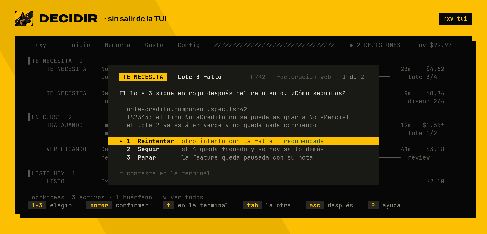

# Decidir desde la TUI

Cuando Claude te hace una pregunta de nxy y tenés la TUI abierta, la contestás ahí, sin volver a la terminal de Claude Code.

▶ [Video: tui-decidir](assets/video/tui-decidir.mp4)

https://github.com/user-attachments/assets/9dccc289-c08e-4cbc-937e-5ea99029462d

## Para qué sirve

Una feature te hace preguntas todo el tiempo: aprobar el plan, qué hacer con un lote que falló, qué hallazgos de la review arreglar, qué rama usar. Con tres features abiertas eso es ir y venir entre terminales. Con la [TUI](tui.md) abierta, nxy retiene la pregunta en vez de mostrarte el diálogo de Claude Code, la dibuja en una ventana y lo que elegís vuelve a Claude como si lo hubieras contestado en el chat. Sin TUI abierta no cambia nada: el diálogo es el de siempre.

## Qué ves

- En la TUI, arriba a la derecha, `● 2 DECISIONES`; la feature que espera aparece en el grupo **Te necesita**, y el título de la terminal pasa a `● nxy: 2 decisiones`.
- En la terminal de Claude Code, el título pasa a `● nxy: decisión pendiente` mientras la pregunta espera.
- Al apretar `d` se abre la ventana: el chip **Te necesita**, el título de la pregunta, la feature y el repo (`F7K2 · facturacion-web`), cuántas hay (`1 de 2`), el contexto, la pregunta, y las opciones numeradas, cada una con su descripción entera en varias líneas, con la **recomendada** marcada. Si no entra en la terminal, `↑` `↓` desplazan la ventana y la opción marcada queda siempre a la vista. Si la pregunta es de varias partes ves `pregunta 1 de 3`.
- Al contestar, Claude sigue como si hubieras elegido en su diálogo; en el registro de la herramienta queda `nxy: contestada en la TUI`.

## Qué significa

La pregunta se contesta en la TUI sólo si nxy la reconoce (mismo texto y mismas opciones que armó él) y viene del hilo principal. Las preguntas que nxy te hace de otra forma se siguen contestando en el chat: guardar una decisión del diseño (`¿guardar la decisión D<n>?`) y cerrar el diseño. Una bifurcación del [modo ingeniero](ingeniero.md) tampoco se contesta en la ventana: `enter` te lleva a la pantalla Ingeniero.

Si estás mirando el **Plan** de una feature que espera aprobación, la ventana no salta encima: ahí se contesta con `a` (aprueba), `c` (elige **Cambiar**) y `x` (para la feature; pide `y`/`n`: «Termina la feature y suelta la pregunta»). Desde cualquier otra pantalla, `d` abre la ventana con la pregunta de aprobación como cualquier otra.

Cómo funciona, en una línea: la TUI marca con un archivo de latido (cada 2 segundos) que está viva; el hook de Claude Code, si ve ese latido de menos de 5 segundos, guarda la pregunta en la base y espera. Cuando contestás, `nxy action decide` anota tu respuesta y el hook se la devuelve a Claude.

La pregunta vuelve al diálogo normal de la terminal, sin que pierdas nada, cuando:

- apretás `t` en la ventana (**en la terminal**),
- cerrás la TUI (el latido se apaga),
- pasan 25 minutos sin respuesta, o
- actualizaste nxy con la TUI abierta (arriba dice «nxy se actualizó: cerrá y volvé a abrir»): esa TUI deja de contar como viva.

El modelo no puede contestarse solo: `nxy action decide` sólo lo acepta si lo corre la TUI (lleva una clave que cambia en cada apertura), y si Claude intenta correrlo, el hook lo rechaza: «nxy action decide is the user's answer from the TUI; ask with AskUserQuestion».

## Qué hacer

1. Abrí la [TUI](tui.md) en otra terminal antes de que Claude llegue a la pregunta (o después: la ve en cuanto aparece).
2. Cuando veas `● N decisiones`, apretá `d`.
3. Elegí la opción con su número (`1`–`9`) o con `↑` `↓`, y confirmá con `enter`. En una pregunta de selección múltiple, `space` marca y desmarca cada opción y `enter` confirma.
4. Si la pregunta tiene varias partes, `enter` pasa a la siguiente y recién con la última se envía todo.
5. Con más de una pregunta abierta, `tab` y `shift+tab` pasan de una a otra. `esc` la deja para después; vuelve a aparecer cuando apretás `d` de nuevo.

| Tecla | Qué hace en la ventana |
| --- | --- |
| `1`–`9` · `↑` `↓` (o `k` `j`) | Elegir una opción |
| `space` | Marcar o desmarcar (selección múltiple) |
| `enter` | Confirmar la opción o pasar a la pregunta siguiente |
| `t` | Contestar en la terminal de Claude Code |
| `tab` · `shift+tab` | La otra pregunta |
| `esc` | Después |
| `q` · `?` · `ctrl+g` | Salir, ayuda, íconos (siguen funcionando) |

Mensajes que podés ver abajo en la TUI (los demás avisos de nxy, en [Mensajes de nxy](mensajes.md)):

| Mensaje | Qué hacer |
| --- | --- |
| `No hay decisiones pendientes.` | Nada: no hay nada que contestar |
| `contestá en la terminal de Claude Code` | Esa pregunta no espera a la TUI (no estaba viva cuando se hizo): contestala en el chat |
| `ya contestada` | La contestaste en otro lado primero. La TUI recarga sola |
| `ya no está esperando: contestá en la terminal de Claude Code` | El hook ya soltó la pregunta (pasaron los 25 minutos o la TUI se había cerrado): contestala en el chat |
| `nxy action decide: sólo lo corre la TUI de nxy (abrila con nxy tui y contestá ahí)` | Corriste `nxy action decide` a mano: no lo hagas, abrí la TUI |

Para probarlo sin una feature real: `nxy tui --demo` y `ctrl+n` simula que llega una decisión. En el demo los botones sólo dicen qué comando correrían.

## Comandos y config

| Comando | Qué hace |
| --- | --- |
| `nxy tui` | La TUI; con ella abierta las preguntas se contestan ahí |
| `nxy action decide --ask <id> --answer <etiqueta> [--answer …]` | Lo que corre la TUI al confirmar. No es para usar a mano |
| `nxy action decide --ask <id> --release` | Lo que corre `t`: devuelve la pregunta a la terminal |

No tiene claves de config: se activa sola cuando hay una TUI viva. La espera del hook es de 25 minutos como máximo, revisando cada 0,3 s.

## Relacionados

- [La TUI](tui.md): las pantallas y las teclas.
- [Una feature, paso a paso](feature.md): qué preguntas aparecen y cuándo.
- [Plan y lotes](plan-y-lotes.md): aprobar, cambiar o parar un plan.
- [Modo ingeniero](ingeniero.md): las bifurcaciones del diseño.
