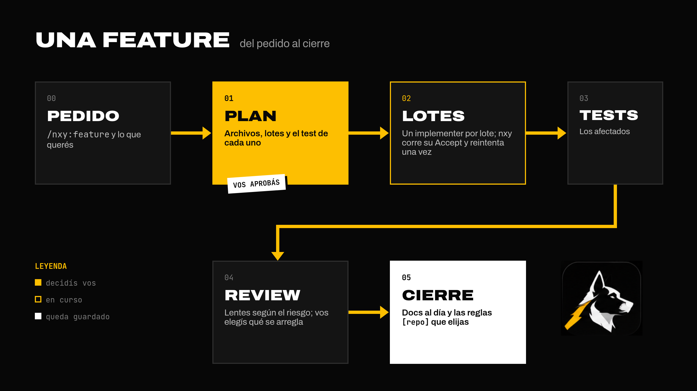

# Una feature, paso a paso

`/nxy:feature <pedido>` convierte un pedido en un plan que aprobás vos, lotes que nxy verifica con un test, una review y los arreglos que elijas.

▶ [Video: feature](assets/video/feature.mp4)

https://github.com/user-attachments/assets/3067635a-c9f8-46f7-b102-13c178b77984

## Para qué sirve

Para los cambios con forma: varios archivos, algo nuevo, o más de un repo. En vez de que Claude edite directo en el chat, nxy conduce el flujo: nada se escribe hasta que aprobás el plan, y el veredicto de cada lote lo decide un test que corre nxy, no el modelo. Todo el estado vive en la base de nxy, así que un `/clear` no pierde nada.

## Qué ves

El recorrido completo, del pedido al cierre:



La TUI muestra una feature en curso con el plan, los lotes y los agentes: probala sin datos con `nxy tui --demo`.

## Qué significa

```
/nxy:feature alta de clientes corporativos con validación de CUIT
```

1. **Planner.** nxy guarda tu pedido tal cual y despacha al *planner* (Opus, effort high). Busca en el repo con `nxy locate`, lee las reglas del repo y arma un plan por lotes: criterios `R1…Rn` (lo que tiene que cumplir esta feature) y, para cada lote, qué cambia, con qué test se prueba (el `Accept:`) y qué riesgo tiene. nxy valida el plan; si está mal, el planner ve los problemas y lo corrige. Si tiene preguntas que sólo vos sabés contestar, te las hace antes del plan. Si la feature es la primera de un repo sin reglas, antes te ofrece proponerlas ([Primer uso](primer-uso.md)).
2. **Aprobás el plan.** Claude te muestra el plan y te pregunta **«¿Aprobás el plan `<id>` r`<n>` de nxy?»** con **Aprobar**, **Cambiar** o **Ver completo**. Hasta que aprobás no se escribe una línea de código. **Ver completo** abre el plan entero en tu editor. **Cambiar** te pide una nota y el planner replanifica; cada replanificación sube la revisión (`r<n>`) y hay que aprobarla de nuevo. También podés aprobar escribiendo **Aprobar** en el chat (o **Ver completo**, **Cambiar**, que actúan como sus opciones; mayúsculas y punto final dan igual); cualquier otro texto no cuenta como aprobación. nxy verifica que la aprobación sea tuya: Claude puede hacer la pregunta, no contestarla por vos. **Los `Accept:` son comandos que nxy va a correr: leelos antes de aprobar.** Con varios repos, al aprobar te pregunta además la rama y la base de cada uno.
3. **Lotes verificados.** nxy despacha un implementer por lote y le escribe el prompt. El implementer prueba con `nxy batch red` y `nxy batch green`, que corren el `Accept:` por él. Si un lote queda en rojo, nxy lo reintenta una vez solo; si falla de nuevo ves **«Lote n fallido»** con la causa y elegís **Reintentar**, **Seguir** (aceptarlo así) o **Parar**. Los lotes que no dependen entre sí (un repo de back y uno de front) corren en paralelo. Detalle: [Plan y lotes](plan-y-lotes.md).
4. **Tests afectados.** Con todos los lotes en verde, nxy calcula qué cambió desde que aprobaste, elige los tests afectados y los corre. Si salen en rojo, un implementer los arregla una vez; si sigue rojo (o no hay nada que correr) ves **Afectados fallidos** o **Afectados sin verificar**, con **Reintentar**, **Seguir** o **Parar**. «Sin verificar» nunca cuenta como verde.
5. **Review.** La profundidad depende del riesgo (ver [Review](review.md)). Ves los hallazgos numerados `H1`, `H2`… con su escenario y su arreglo, y **elegís cuáles se arreglan**. Un único implementer arregla los elegidos y nxy vuelve a correr los afectados.
6. **Docs.** Si algún documento para usuarios (README, un `.md` en la raíz, o lo que esté en `docs/`, `doc/`, `documentation/` o `wiki/`) nombra lo que cambió, te ofrece **Actualizar docs** o **Dejar**.
7. **Cierre.** Ves `Listo · R1 ✔ <test> · …`: qué criterio quedó probado con qué test, y qué arreglos se aplicaron. `R2 ✔ arreglo H1` significa que el criterio falló en la review y lo dejó en verde el arreglo elegido (H1), con los afectados verificados en verde; si los afectados quedaron en rojo o sin verificar, sigue `R2 ✘`. Si algo quedó «sin verificar», lo dice: corré tus tests a mano. Después te ofrece guardar como reglas del repo las decisiones marcadas `[repo]` (de a 4 por pregunta); si no elegís nada, no se guarda nada. Vos mirás el diff, commiteás y abrís el PR: **nxy nunca commitea ni pushea**.

### Qué agente corre cada cosa

Cada uno se cambia por config con `roles.<rol>.model` y `roles.<rol>.effort` ([Configuración](configuracion.md)).

| Agente | Qué hace | Modelo | Effort |
| --- | --- | --- | --- |
| `planner` | Arma el plan por lotes | Opus | high |
| `implementer` | Escribe un lote o un arreglo y prueba con `nxy batch` | Sonnet | medium |
| `reviewer` | Revisa el cambio con una lente | Sonnet | high |
| `reviewer-quick` | La review completa de un cambio de riesgo bajo | Sonnet | medium |
| `refuter` | Intenta refutar los hallazgos graves de la review | Sonnet | high |
| `scout` | Encuentra dónde está algo y explora para el diseño | Sonnet | medium |
| `documenter` | Actualiza los docs que nombran lo cambiado | Sonnet | low |

### Mientras hay una feature sin terminar

El hilo principal tampoco escribe el repo: ni con `Edit` ni por consola (`echo > archivo`, `sed -i`, `tee`, `cp`, `mv`); escribe el implementer. No tenés que hacer nada. Fuera del repo y sobre `.git` o `.nxy` no pasa nada. Si ves un rechazo que empieza con `nxy: feature <id> is in progress`, es esto ([El freno](gate.md)).

### El estado de una feature

`nxy status` dice dónde está en cuatro estados:

| Estado | Quiere decir |
| --- | --- |
| **Trabajando** | nxy o un subagente hace algo (planificando, ejecutando un lote, arreglando) |
| **Verificando** | Se corre una prueba (un lote, los afectados, la review) |
| **Necesita tu decisión** | Te toca a vos: responder, aprobar, reintentar o parar |
| **Listo** | Terminó (con éxito, o «Parada» si la cortaste) |

`/nxy:feature` (y `/nxy:engineer`) arranca **sólo escrito o pegado al principio del mensaje** (aceptan espacios, backticks o un bloque de código alrededor); Claude no puede arrancarla por vos: si lo intenta, nxy lo rechaza y te pide que la tipees. Si el comando está en una línea posterior, nxy te avisa que no arrancó ninguna feature. Para aprobar el plan podés usar el diálogo o escribir la aprobación en el chat (después de **Ver completo** también); nxy la toma igual. Ver los [mensajes](mensajes.md).

Hay **una sola feature sin terminar por checkout**; si ya hay una, `/nxy:feature` la rechaza con `feature <id> in progress (<estado>); next step …; to end it: nxy feature stop`. Un `/clear`, una compactación o abrir otra sesión no pierden nada. Una sesión nueva puede tener su propia feature en la misma carpeta sólo si la que la ocupa pertenece a otra sesión viva.

## Qué hacer

- **Leé el plan como un diseño en un PR.** ¿Reusa lo que existe? ¿Cada `Accept:` prueba lo correcto? Si no, **Cambiar** con una nota.
- **Contestá las preguntas** del planner: son bifurcaciones reales que no pudo resolver mirando el repo (la opción recomendada va primera).
- **Elegí qué hallazgos arreglar.** Los preexistentes son informativos; marcá sólo los que querés antes del PR, o «Ninguno».
- **Para cortar en cualquier punto:** `nxy feature stop` (libera las ediciones y borra el plan `.md` y la review `.md`). La feature queda «Parada».
- **Si Claude Code muestra «Stop hook error»** cuando un paso pendiente llega justo al terminar el turno: es el rótulo de Claude Code, no un error. nxy usa ese camino para que Claude siga.
- **Si decidís el diseño vos**, usá `/nxy:engineer` en lugar de `/nxy:feature` (también aparece como la oferta **Pasar a engineer** entre las preguntas del planner).

### Notas para retomar

Una nota (`N3`) es algo que dejaste a medias en una carpeta, para retomar en otra sesión sin releer el chat. Sin feature activa y con notas en la carpeta, tu primer mensaje dispara la pregunta «¿Con cuál seguimos?» (elegí una, o «Ninguna, es otra cosa»). Una nota guardada en una rama se borra sola cuando esa rama se mergea en la base o ya no existe; las demás vencen a los 30 días. No son lo mismo que los aprendizajes de la [memoria](memoria.md).

## Comandos y config

| Comando | Para qué |
| --- | --- |
| `/nxy:feature <pedido>` | Arranca la feature |
| `/nxy:engineer <pedido>` | Arranca la feature en modo ingeniero |
| `nxy status` | Dónde está la feature de esta carpeta |
| `nxy feature stop [--feature <id>]` | La termina en cualquier punto |
| `nxy feature rule "<texto>" --question "<qué resuelve>"` | Anota una regla candidata de la feature activa; se pregunta al cerrar, no se guarda ahora |
| `nxy note save "<título>"` · `list [--all]` · `done <id>` | Notas para retomar (el cuerpo va por stdin, hasta 2 KB) |
| `nxy batch red\|green --feature <id> [--batch <n>]` | Lo corre el implementer, no vos: ejecuta el `Accept:` del lote |

Config: `roles.<rol>.model` y `roles.<rol>.effort` para cada agente; en `nxy config set <clave> <valor> [--repo]` (ver [Configuración](configuracion.md)).

## Relacionados

- [Plan y lotes](plan-y-lotes.md): qué trae el plan y cómo se verifica cada lote.
- [Review](review.md): lentes, refuter y qué hacer con un hallazgo.
- [Memoria](memoria.md): las reglas que reciben los agentes.
- [Modo ingeniero](ingeniero.md): decidir el diseño antes de planificar.
- [Varios repos y worktrees](varios-repos.md): una feature que cruza repos.
- [La TUI](tui.md) y [Decidir desde la TUI](decidir.md): seguir la feature y contestar sin volver al chat.
- [Buscar](buscar.md): cómo el planner encuentra el código.
- [Primer uso](primer-uso.md)
