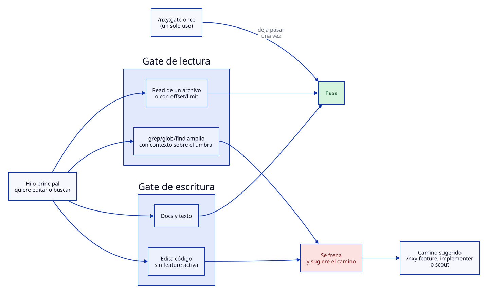

# El freno (gate)

Dos frenos que cuidan el contexto del hilo principal: uno para escribir código sin una feature y otro para las búsquedas amplias con la sesión ya cargada. Frenan con un mensaje que le dice a Claude qué hacer; casi nunca te toca actuar.

## Para qué sirve

Todo lo que el hilo principal lee o escribe se queda en el contexto y se reenvía en **cada** llamada siguiente ([Gasto](gasto.md)). Una búsqueda amplia con 150k encima arrastra los resultados en todos los pasos que vienen; una edición hecha ahí mismo se paga igual. El freno manda ese trabajo a un subagente (el implementer para escribir, el scout para buscar), que arranca limpio, paga lo que lee una vez y devuelve un resumen corto.



## Qué ves

`/nxy:gate status` (o `nxy gate status` en una terminal) muestra el estado de los dos frenos, los permisos de una sola vez y lo que registró:


```
gate de escritura:  activo (sin una feature, el hilo principal no edita archivos de código; docs y texto pasan)
gate de lectura:    activo (se frena un grep/glob/find amplio con más de 100k tokens de contexto en el hilo principal)
edición única:      no
escape de búsqueda: no

decisiones:         todavía no pasó ninguna edición por el gate en este repo
búsquedas:          0 frenadas, 0 dejadas pasar con `/nxy:gate once search`
búsquedas amplias:  ninguna registrada (desde 2026-10-19)
```

Cuando frena, ves el rechazo en el chat (Claude lo lee y cambia de camino). Los dos textos:

- Escritura: `nxy: no feature is active — the main thread does not edit code `<archivo>` itself.` y debajo: arrancá una feature con `/nxy:feature`, o despachá al `implementer` si es algo puntual; «Docs and plain text are not stopped»; y «If doing it here really is cheaper, the user can run `/nxy:gate once`.»
- Lectura: `nxy read gate: main thread context is 150k > 100k — a broad grep for `<patrón>` would pull its results into every later call.` y debajo: despachá `nxy:scout` con la pregunta, o acotá a un archivo o a un `Read` con `offset`/`limit`; y «the user can run `/nxy:gate once search` to let one search through.» La primera vez de cada sesión suma una última línea: «To stop this in this repo: `/nxy:gate reads off`».

## Qué significa

**El freno de escritura.** Sin una feature activa, el hilo principal no edita **archivos de código** del repo: ni con `Edit`, `Write`, `NotebookEdit` o `MultiEdit`, ni por consola (`echo > archivo`, `sed -i`, `tee`, `cp`, `mv`, y lo equivalente en PowerShell). Es un análisis del texto del comando, no una garantía: scripts, `xargs`, variables y comodines no se reconocen. Cuenta como código lo que el mapa del repo indexa (JS/TS, Java, Scala, Python, Go, C#; ver [Buscar](buscar.md)) más la extensión de los tests de tus runners (por ejemplo `.kt`). Pasan: los docs y el texto, lo que está afuera del repo y todo lo que hace un subagente (el implementer nunca se frena). El freno de escritura **no** depende de cuánto contexto tenga la sesión.

Con una feature activa el freno es otro y total: el hilo principal no escribe el repo, escribe el implementer (`nxy: feature <id> is in progress — the main thread does not write code; …`). Eso lo explica [Una feature, paso a paso](feature.md).

**El freno de lectura.** Frena una búsqueda **amplia** del hilo principal cuando su contexto llega al umbral (`gate.contextTokens`, 100k por defecto). Es amplia un `Grep` o `Glob` que no apunta a un solo archivo, y por consola `rg`, `git grep`, `grep -r`, `find`, `fd`, `Get-ChildItem -Recurse` o `Select-String` sin ruta de archivo. Nunca frena un `Read` (entero, con `offset`/`limit`), una búsqueda sobre un archivo ni a un subagente. Si no puede medir el contexto, deja pasar. Límite conocido: una carpeta con un punto en el nombre (`v1.2`) el chequeo rápido la toma por un archivo, así que una búsqueda sobre ella no se frena.

**Una sola vez.** `/nxy:gate once` arma un permiso para la próxima edición de código del hilo principal; `/nxy:gate once search`, para la próxima búsqueda amplia. Cada uno se gasta al usarse, vence a los `gate.escapeMinutes` (5 por defecto, mínimo 1) y es independiente del otro. Si un comando de consola escribe varios archivos de código, un permiso alcanza para todo ese comando.

**Fallar abierto.** Ante cualquier dato que no puede leer, el freno deja pasar: un freno que falla cerrado te rompe el editor.

**Lo que registra.** Cada edición del hilo principal dentro del repo, y cada búsqueda frenada o dejada pasar con `once search`, suma una fila de unos 150 bytes a `.nxy/local/metrics/gate.jsonl` (tope de 256 KB: al pasarlo se descartan las de más de 90 días y, si todavía sobra, quedan las más nuevas). Las líneas de `status`:

| Línea | Qué dice |
| --- | --- |
| `gate de escritura` / `gate de lectura` | Si están prendidos y, el de lectura, desde qué umbral frena (`apagado (no se frenan las búsquedas amplias)` si `gate.reads` es `false`; `DESACTIVADO` si `gate.enabled` es `false`) |
| `edición única` / `escape de búsqueda` | `no`, o `armado, quedan N min` |
| `decisiones` | Cuántas ediciones se bloquearon de las que pasaron por el freno, y el contexto (`p10`, `p50`, `p90`, `max`) con el que editaste |
| `búsquedas` | Cuántas se frenaron y cuántas se dejaron pasar con `once search` |
| `búsquedas amplias` | Las que el hilo principal hizo con el contexto sobre el umbral en los últimos 30 días (`--since 7d` cambia el período), y cuánto contexto cargaban esas llamadas |

`búsquedas amplias` sale de los transcripts de Claude Code, no del registro del freno, así que cubre también sesiones pasadas y no gasta nada mientras trabajás. Es una cota superior de lo que costó cada llamada, no de lo que habría ahorrado un scout; las que el freno rechazó no se cuentan porque no corrieron.

## Qué hacer

Casi siempre, nada: Claude lee el rechazo y manda un scout o arranca una feature. Cuando vos querés decidir:

| Querés | Hacé |
| --- | --- |
| Dejar pasar **una** edición de código del hilo principal | `/nxy:gate once` |
| Dejar pasar **una** búsqueda amplia | `/nxy:gate once search` |
| Apagar el freno de búsquedas en tu usuario | `/nxy:gate reads off` (`reads on` lo vuelve a prender) |
| Apagarlo sólo en este repo | `/nxy:gate reads off --repo` |
| Apagar los dos frenos | Editá el JSON: `"gate": { "enabled": false }` en `~/.nxy/config.json` (o en `.nxy/config.json` para un repo) |
| Cambiar el umbral o la vida de un permiso | Editá `gate.contextTokens` o `gate.escapeMinutes` a mano ([Configuración](configuracion.md)) |
| Ver cuánto frenó | `/nxy:gate status` |

`reads on|off` guarda `gate.reads` en `~/.nxy/config.json`, o en el `.nxy/config.json` del repo con `--repo`, y conserva las otras claves. Si ese archivo está roto, no lo toca y lo dice (`<ruta> está roto; no se toca`): arreglalo a mano y repetí. Claude no edita esa config por su cuenta.

## Comandos y config

| Comando | Qué hace |
| --- | --- |
| `/nxy:gate [status]` · `nxy gate [status]` | El estado completo |
| `/nxy:gate once` | Un permiso de edición de código, una sola vez |
| `/nxy:gate once search` | Un permiso de búsqueda amplia, una sola vez |
| `/nxy:gate reads on\|off [--repo]` | Prende o apaga el freno de búsquedas |
| `nxy gate status --since 7d` | Cambia el período de `búsquedas amplias` (por defecto 30 días) |
| `nxy gate … --cwd <carpeta>` | Otra carpeta en vez de `CLAUDE_PROJECT_DIR` o la actual |

Con una acción que no existe, `nxy gate` responde `no conozco la acción "<x>". Usá: status | once [search] | reads on|off [--repo]` y muestra igual el estado.

| Clave | Por defecto | Qué hace |
| --- | --- | --- |
| `gate.enabled` | `true` | `false` apaga los dos frenos |
| `gate.reads` | `true` | `false` deja el freno de búsquedas sólo observando |
| `gate.contextTokens` | `100000` | Desde cuántos tokens de contexto del hilo principal se frena una búsqueda amplia |
| `gate.escapeMinutes` | `5` | Cuánto dura un `once` armado antes de vencer solo |

## Relacionados

- [Buscar](buscar.md): el scout y `nxy locate`, el camino que sugiere el freno de lectura.
- [Una feature, paso a paso](feature.md): el implementer y el freno total con una feature activa.
- [Ver en qué se gasta](gasto.md): por qué importa el contexto del hilo principal.
- [Mensajes de nxy](mensajes.md) · [Configuración](configuracion.md)
