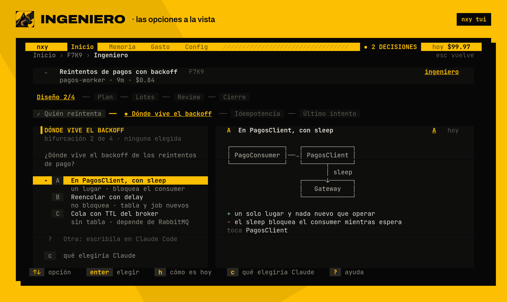

# Modo ingeniero

Para los cambios donde querés decidir el diseño vos, bifurcación por bifurcación, antes de que nadie planifique ni toque código.

## Para qué sirve

En una feature común, el planner arma el plan y vos lo aprobás. Eso alcanza cuando el cambio tiene una forma obvia. Cuando no (dónde vive el backoff de los reintentos, si se agrega una tabla o se reencola, qué contrato queda entre dos repos), conviene que la decisión sea tuya y quede escrita: en modo ingeniero Claude te presenta las opciones con su trade-off, te refuta si proponés algo, y recién cuando cerrás el diseño arranca el planner, con tus decisiones como entrada.

## Qué ves



- `nxy status` dice **Diseñando**, y el chat muestra la agenda: `Agenda: 3 de 5 decididas`, con cada bifurcación `B1`, `B2`… y su estado (`abierta`, `decidida`, `delegada`).
- Antes de debatir, Claude hace un reconocimiento con un scout (nunca lee archivos en el hilo principal) y dibuja un diagrama chico de cómo es hoy.
- En la TUI, la pantalla **Ingeniero** muestra la agenda como fichas (`✓` decidida, `●` la actual), la pregunta de la bifurcación, las opciones como tarjetas `A`, `B`, `C` con su resumen, y a la derecha el diagrama, los `+` y `−` de la opción bajo el cursor y qué archivos toca. Siempre hay una última fila `?  Otra: escribila en Claude Code`.

## Qué significa

- **Todavía no hay plan ni se toca código.** El hilo principal sólo conversa, busca con scouts y guarda lo que decidís.
- **Una bifurcación** es una decisión de diseño con 2 a 4 opciones. Cada opción tiene una línea de resumen, hasta 4 pros y 4 contras, y qué toca.
- **La opinión de Claude está guardada pero oculta.** Es condicionada («B, salvo que X») y no la escribe en el chat hasta que la pedís, para no condicionarte. En la TUI está detrás de `c`.
- **Claude no cede por insistencia.** Cambia de opinión sólo con un argumento y dice cuál. Si cerrás con tu opción igual, la decisión queda guardada con su desacuerdo («Claude mantiene su desacuerdo: …»).
- **Revisión técnica no pedida.** Si ve un N+1, un índice que falta, una carrera, una transacción, un contrato roto o un problema de seguridad, te lo marca con `path:línea`, o como duda si no lo verificó.
- **Cada decisión es `D1`, `D2`…**, con su porqué. Las que valen para todo el repo (`repo`) se ofrecen como reglas al cerrar la feature; las `task`, sólo para esta ([Memoria](memoria.md)). En este modo el hilo principal recibe todas las reglas del repo para refutar el diseño contra ellas.
- **El planner respeta el diseño.** Copia tus criterios tal cual, no te hace preguntas y sólo decide las bifurcaciones que le delegaste. Si encuentra un agujero que el diseño no cubre, no lo inventa: lo devuelve (`nxy plan gaps`) y la feature vuelve a **Diseñando** con esa bifurcación abierta.
- **Un `/clear` es seguro.** Las decisiones, la agenda y tus últimos mensajes del diseño están en la base, y Claude los recibe de nuevo al retomar.

## Qué hacer

1. Pedí el cambio con `/nxy:engineer`:

```
/nxy:engineer reintentos de pagos con backoff, sin perder mensajes
```

También aparece como oferta dentro de `/nxy:feature`: si el planner te hace preguntas, la primera es **«¿pasar a engineer para decidir esto con vos?»**, con **Pasar a engineer** o **Responder acá**. Si en esa misma pregunta ya contestaste alguna de las del planner, esas respuestas quedan registradas en su bifurcación (`B1`, `B2`…) y Claude no te las vuelve a preguntar: propone esa decisión para que la confirmes.

2. Debatí cada bifurcación, en el chat o en la TUI. Para elegir una opción tenés dos caminos: pedírselo a Claude, que te hace la pregunta de la bifurcación (`¿qué opción elegís para B1?`), o apretar `enter` sobre la opción en la pantalla Ingeniero. Con la pregunta abierta, `enter` la contesta. Sin pregunta abierta, `enter` guarda tu elección («guardada B: Claude la recibe en tu próximo mensaje»): la opción queda marcada con **✓ elegida**, Claude la recibe en tu próximo mensaje, propone esa decisión y, si hace la pregunta de la bifurcación, nxy la contesta solo con tu opción. Otro `enter` sobre otra opción cambia la elección; si la bifurcación o sus opciones cambian, la elección se descarta.
3. Cuando te decidís, Claude propone la decisión y te pregunta **«¿guardar la decisión D1?»** con **OK, guardar** o **Seguir debatiendo**. Nada queda guardado sin ese OK. Esta pregunta se contesta en el chat.
4. Cuando no quedan bifurcaciones, te muestra el cierre (las decisiones, los criterios `R1…Rn` que va a cumplir la feature y las bifurcaciones que elige el planner) y te pregunta **«¿cerrar el diseño y planificar?»** con **Cerrar y planificar** o **Seguir diseñando**. Si decís «decidí vos el resto», las que queden abiertas pasan al planner y quedan marcadas como suyas.
   Para sumar un criterio después de cerrar el diseño, en la aprobación del plan elegí **Cambiar** y escribilo en la nota: el planner lo agrega como `R<n+1>` después de los aprobados, que no cambian, y lo aprobás junto con el plan; al aprobar queda en el diseño. Sin esa nota, un criterio extra se rechaza.
5. De ahí en más es una feature común: plan, tu aprobación, lotes y review ([Una feature, paso a paso](feature.md)).

Teclas de la pantalla Ingeniero (`enter` desde Inicio sobre una feature en diseño):

| Tecla | Qué hace |
| --- | --- |
| `↑` `↓` | Moverte entre las opciones |
| `enter` | Elegir la opción: contesta la pregunta si Claude ya la hizo; si no, guarda tu elección y Claude la recibe en tu próximo mensaje |
| `h` | Alternar el diagrama de **cómo es hoy** («Así es hoy») |
| `c` | Mostrar u ocultar **qué elegiría Claude** |
| `esc` | Volver |

Los diagramas los dibuja `d2` si lo instalaste (`/nxy:setup`, ver [Instalación](instalacion.md)); sin `d2` ves la fuente del diagrama como texto, y todo lo demás funciona igual. Si un diagrama tiene un error, nxy se lo devuelve a Claude para que lo corrija antes de guardarlo.

Cuando no hay dibujo, el aviso debajo de la fuente dice por qué:

- `d2 no está: instalalo desde Config`: no hay `d2` instalado; instalalo y el dibujo aparece solo.
- `el dibujo tiene un error: <mensaje>`: `d2` no pudo dibujar esa fuente; Claude recibe el mismo error y la corrige.
- `d2 tardó: se reintenta solo`: `d2` no terminó a tiempo; la TUI lo vuelve a intentar en la próxima carga, sin que hagas nada.

## Comandos y config

| Comando | Qué hace |
| --- | --- |
| `/nxy:engineer <pedido>` | Empieza una feature en modo ingeniero |
| `nxy design agenda\|fork\|today\|propose\|close --feature <id>` | Los pasos del diseño. **Los corre Claude**, con un JSON por stdin; no hace falta que los uses |
| `nxy plan gaps --feature <id>` | Lo corre el planner cuando el diseño tiene un agujero |
| `nxy status` | Dónde está la feature (`Diseñando`, `Plan`, …) |
| `nxy feature stop` | Termina la feature en cualquier punto |

El diseño no tiene claves de config propias. El modelo y el effort de los agentes se cambian con `roles.<rol>.model` y `roles.<rol>.effort` ([Configuración](configuracion.md)); el scout del reconocimiento es el mismo de [Buscar](buscar.md).

## Relacionados

- [Una feature, paso a paso](feature.md): el flujo común y la oferta de pasar a engineer.
- [Plan y lotes](plan-y-lotes.md): lo que pasa después del cierre del diseño.
- [Decidir desde la TUI](decidir.md): las otras preguntas de nxy.
- [La TUI](tui.md) · [Memoria](memoria.md)
