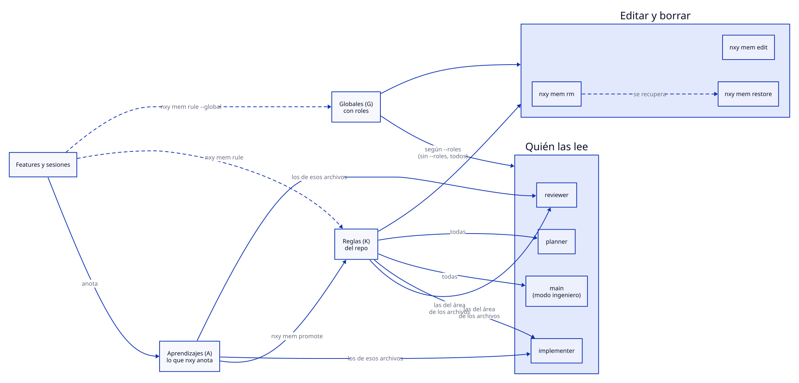

# Memoria

Las reglas de tu repo, tus reglas globales y lo que nxy va aprendiendo: guardado en una base local, entregado solo a los agentes que lo necesitan.

<!-- video memoria: reemplazá esta línea por la URL de user-attachments de docs/assets/video/out/memoria.mp4 -->

## Para qué sirve

Lo que decidiste en una sesión se va con el `/clear`. La memoria de nxy es una base local (SQLite, sin servidor) en `~/.nxy/nxy.db`, que identifica cada repo por su remote de git (sin remote, por la ruta): el mismo repo es el mismo proyecto en otra carpeta, otra máquina o un worktree. Así el planner, el implementer y el reviewer respetan lo que ya decidiste sin que se lo repitas.

## Qué ves

Tres cosas distintas, y cómo circulan entre sí y hacia los agentes:



En la TUI, la pantalla Memoria las lista y deja editar, borrar y crear sin escribir comandos:


Y desde la terminal (o con `/nxy:mem`):


## Qué significa

| Qué | Para qué | Cómo se numera |
| --- | --- | --- |
| **Regla del repo** | Una decisión que las tareas futuras de este repo tienen que seguir. Siempre dice la pregunta que resuelve | `K3` |
| **Regla global** | Tuya, para todos tus repos («no commiteo desde el agente») | `G2` |
| **Aprendizaje** | Algo que notaste y todavía no es regla. Repetirlo suma «visto N veces», no crea otro | `A7` |

El número no se reutiliza nunca, ni siquiera después de borrar.

### Qué recibe cada agente

- **Planner:** todas las reglas del repo (si no hay, ve «(no repo rules yet)»).
- **Implementer y reviewer:** las reglas del área que toca el lote o el diff (las que no tienen `--paths` valen para todo) y los aprendizajes de esos archivos. Un aprendizaje cuyos archivos ya no existen en tu checkout no se entrega.
- **Hilo principal, sólo en modo ingeniero:** todas las reglas, para refutar el diseño contra ellas.
- **Las globales** llegan después de las del repo, a los roles que cada una elige (ver abajo).

Con un tope de **3.000 caracteres** (unos 750 tokens) por despacho: lo que no entra queda en una línea `not shown (budget): K4, K9 - run nxy mem show`. Si hay una contradicción entre una global y una regla del repo, la del repo gana, y las globales son las primeras en quedar afuera.

Un hallazgo de la review que cita una regla sube a severidad media como mínimo.

### Las globales

`--global` crea una regla tuya (`G<n>`), y `--roles planner,implementer,reviewer,main` elige quién la recibe; sin `--roles`, la reciben todos esos cuatro. Nunca le llegan al scout, al refuter ni al documenter. `--roles` sin `--global` da error.

### Cómo se ofrecen

- Al cerrar una feature, nxy te propone guardar las decisiones `[repo]` del plan.
- Si con una feature activa escribís «siempre», «nunca» o «de ahora en adelante» (o `always`, `never`, `from now on`), nxy le pide a Claude que te pregunte si es una regla del repo. Nunca la guarda sin que lo confirmes.
- En un repo sin reglas, la primera feature ofrece proponerlas (`/nxy:mem bootstrap` también): un scout lee el build, los linters y el CI y te propone hasta 10.
- Los aprendizajes los puede sumar un implementer o un reviewer al terminar (hasta 5 por informe, 300 caracteres cada uno). Uno que se comprueba falso, o cuyos archivos ya no existen, queda **obsoleto**: se marca, no se borra.
- Un hallazgo que la review no vio (`/nxy:review escape`) también termina como regla.

### Qué marca `show`

`/nxy:mem show` lista las reglas con `entregada N` (cuántas veces se le entregó a un agente) y `citada M` (cuántas veces un reviewer la citó al encontrar que el cambio la rompía). `para revisar` marca las que llevan 90 días sin citarse (desde que se crearon o se citaron por última vez). Debajo van las globales y los aprendizajes, con `visto N veces`: los más vistos van primero y traen el comando para promoverlos. Si juntás más de 3.000 caracteres de reglas, avisa «demasiadas reglas para un despacho».

En la TUI, la pantalla Memoria marca sólo lo raro y lo convierte en una propuesta que contestás con `y` o `n`: una regla entregada 10 veces o más y nunca citada (**Borrarla**), un aprendizaje visto 2 veces o más (**Hacerla regla**), o uno que vino de la 1.x como global. Con `n` la propuesta no se repite (queda «dejada»).

### Notas: otra cosa

Una **nota** (`N3`) es algo que dejaste a medias en una carpeta, para retomar en otra sesión; vence a los 30 días. Es distinta de un aprendizaje: la nota es de la carpeta y es temporal (`nxy note`), el aprendizaje es del repo y dura (`nxy mem note`). Ver [Una feature](feature.md).

## Qué hacer

```
/nxy:mem rule "Los montos son BigDecimal" --question "¿Qué tipo se usa para dinero?" --paths "src/billing/**"
/nxy:mem rule "No commiteo desde el agente" --question "¿Quién commitea?" --global --roles implementer,reviewer
/nxy:mem note "El importador de CSV falla con BOM" --files src/import/csv.go
/nxy:mem promote A7 --question "¿Qué hacemos con el BOM del CSV?"
/nxy:mem show
/nxy:mem search "cómo guardamos los montos"
```

- **Guardar una regla** siempre pide la pregunta que resuelve (`--question`); sin ella el comando falla. Con `--paths` (globs separados por coma) vale sólo para esa área.
- **Cambiar** sin perder el historial: `nxy mem edit <K3|G2|A7>` con `--text`, `--question`, `--paths`, `--roles` o `--files`. El número, las entregas y las citas quedan.
- **Borrar y recuperar:** `nxy mem rm <ref>` y `nxy mem restore <ref>` (vuelve con el mismo número).
- **Dejar una propuesta:** `nxy mem keep <ref>` marca «dejarla»: nxy no la vuelve a proponer.
- **Reemplazar una regla:** `--supersedes K3` al crear la nueva.
- **Buscar:** `nxy mem search <texto> [--all]`.
- **Tareas cerradas:** `/nxy:mem related <archivos>` lista las features cerradas y los aprendizajes que tocaron esos archivos; el planner lo corre antes de armar un plan.
- **En la TUI:** `/` busca, `e` edita, `x` borra (pide confirmación con `y`/`n`; `u` deshace durante 5 segundos), `+` crea, `[` y `]` cambian de repo.

### Compartir con el equipo

`/nxy:mem export [--out archivo] [--notes]` escribe un JSON versionado que se commitea como cualquier cambio. `/nxy:mem import <archivo>` **sin** `--apply` sólo muestra qué cambiaría (nuevos, cambiados, borrados, unificados, salteados); con `--apply` lo aplica en una sola transacción. Gana el más nuevo y los borrados viajan. Las notas temporales sólo viajan con `--notes`.

Cuánto pesa: una regla ~0,5 KB y un aprendizaje ~0,3 KB; 100 reglas y 500 aprendizajes caben en ~1 MB de la base.

## Comandos y config

| Comando | Qué hace |
| --- | --- |
| `nxy mem rule "<texto>" --question "<q>" [--paths g1,g2] [--origin chat] [--feature id] [--supersedes K3] [--global [--roles a,b]]` | Guarda una regla |
| `nxy mem note "<texto>" [--files a,b]` | Guarda un aprendizaje |
| `nxy mem promote <A7> --question "<q>" [--paths g1,g2]` | Convierte un aprendizaje en regla |
| `nxy mem edit <K3\|G2\|A7> [--text …] [--question …] [--paths …] [--roles …] [--files …]` | Cambia lo que pasás |
| `nxy mem rm <ref>` · `restore <ref>` · `keep <ref>` | Borrar, recuperar, «dejar» |
| `nxy mem show` · `search <texto> [--all]` · `related <archivos…>` | Mirar y buscar |
| `nxy mem export [--out archivo] [--notes]` · `import <archivo> [--apply]` | Compartir |
| `nxy mem bootstrap` | Propone las primeras reglas del repo |
| `nxy note save\|list\|done` | Notas temporales de la carpeta |
| `nxy feature rule "<texto>" --question "<q>"` | Una regla candidata para la pregunta de cierre |

La memoria no tiene claves de config propias: se prende sola cuando hay base. Dónde vive cada archivo: [Configuración](configuracion.md).

## Relacionados

- [Una feature, paso a paso](feature.md): cuándo se ofrecen las reglas.
- [Plan y lotes](plan-y-lotes.md): las decisiones `[repo]` que pasan a ser reglas.
- [Review](review.md): los hallazgos que citan una regla y los escapes.
- [La TUI](tui.md): la pantalla Memoria.
- [Buscar](buscar.md): `/nxy:mem related` y el scout.
- [Modo ingeniero](ingeniero.md): el hilo principal recibe las reglas del repo.
- [Instalación](instalacion.md)
