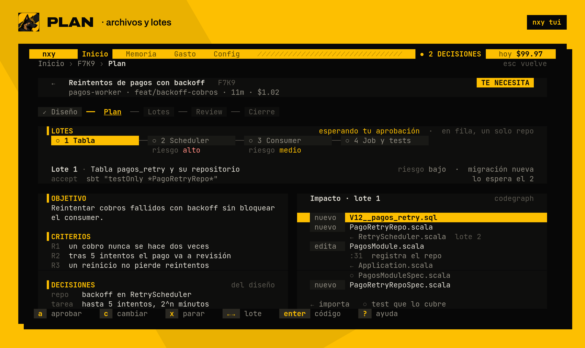

# Plan y lotes

Qué trae el plan que te pide aprobar nxy, cómo se verifica cada lote con su `Accept:` y qué hacer cuando algo queda en rojo.

## Para qué sirve

El plan es el contrato de la feature: lo que tiene que cumplirse (criterios), en qué pasos (lotes) y con qué prueba se demuestra cada paso. Lo aprobás vos antes de que se escriba código, y después **nxy corre las pruebas**: el veredicto de un lote lo decide un comando con su código de salida, no lo que el modelo diga que hizo.

## Qué ves

En la TUI, la pantalla del plan muestra los lotes con su estado, y el plan completo se abre como archivo:



En el chat, el plan llega como un resumen con esta forma:

```
## Alta de clientes corporativos

### Lote 1 — Validar el CUIT
- Cubre: R1, R2
- Cambiar:
  - src/clientes/cuit.go:12 — función ValidarCUIT con dígito verificador
- Test: TestValidarCUIT (nuevo)
- Accept: `go test ./src/clientes -run TestValidarCUIT`
- Riesgo: bajo
```

Si el plan trae un diagrama, el resumen del chat y **Ver completo** suman una sección `### Diagrama` con la fuente en un bloque `d2`: cómo se conectan las piezas que toca el plan. La TUI lo dibuja. Leelo antes de aprobar; si el planner no lo pidió o no hizo falta, la sección no aparece. En modo ingeniero, si el plan no trae diagrama propio, se muestra el del diseño.

## Qué significa

- **Criterios (`R1…Rn`).** Lo verificable que sale del pedido. Cada uno tiene un tipo de test: `tdd` (un test nuevo, que primero falla), `existing` (ya existe), `build` (compila o pasa el typecheck) o `manual` (lo mira una persona; el plan dice qué). Todo criterio tiene que estar cubierto por algún lote.
- **Decisiones.** Las que tomó el planner, marcadas `[repo]` (valen para todo el repo: al cerrar podés guardarlas como reglas) o `[task]` (sólo para esta feature).
- **Lotes.** Una unidad de comportamiento: código, su test y sus docs juntos. Cada lote dice qué cubre, qué cambia (`path:line` y qué), con qué test se prueba, su riesgo y, si hace falta, `Depende de:` otros lotes.
- **`Accept:`.** El comando más chico que prueba el lote (no toda la suite). **Es lo que nxy va a ejecutar**: leelo antes de aprobar.
- **Riesgo.** Bajo, medio o alto, según el planner. Si dice «subido por nxy», es que vio archivos de seguridad, base de datos o migraciones; nxy sólo sube el riesgo, nunca lo baja. Define cuánta review hay ([Review](review.md)).
- **`Suite:`.** El comando de toda la suite, que nxy usa sólo si no puede calcular los tests afectados.
- **Preguntas.** Si hay una bifurcación que el repo no resuelve, el planner te pregunta antes del plan (hasta 4 preguntas, 2 a 4 opciones, la recomendada primero).
- **Sin tests.** Si el pedido no se puede probar con un test, el planner lo declara y la feature pasa al estado «Sin tests» y nxy te lo consulta antes de seguir.

### Cómo se verifica un lote: rojo y verde

Para cada lote el implementer corre dos comandos que ejecutan el `Accept:` por él:

- **`nxy batch red`**, antes del código, sólo cuando el lote trae un test nuevo que cubre un criterio `tdd`: el test tiene que **fallar**. Si pasa, nxy no lo registra («the recorded red passed: the test must fail before the code»). Un rojo logrado con un stub (código comentado, revertido o reemplazado a propósito) no prueba nada: el implementer no puede hacerlo y, si el comportamiento ya existía y el test pasa, lo avisa en su respuesta en lugar de forzar el rojo.
  - **Rojo después de código.** Si antes del `red` el lote ya escribió código que no es test (ni `testdata`, golden o docs), nxy graba el rojo igual, porque no puede saber si el test es bueno, pero lo avisa en la salida con los archivos («code written before the red (…)»). Qué significa: el rojo puede venir de un stub y no probar el test. Qué hacer: nada de tu lado; el reviewer base lista ese lote con sus archivos y verifica que el test falla sin ese código.
- **`nxy batch green`**, después del código: tiene que **pasar**. Si falla, ve `green failed (exit N): fix and run green again`. Un verde sólo cuenta si no se escribió nada después: si el implementer edita otra vez, tiene que volver a correr `green`.
  - **En Go, el formato también cuenta.** Si el `Accept:` pasa pero algún `.go` que cambió el lote no está formateado con `gofmt`, el verde no se registra: ves `Go files are not gofmt-formatted: <archivos>; run gofmt -w <archivos> and run green again`. Significa que la review iba a encontrar ese formato igual. El implementer corre `gofmt -w` sobre esos archivos y vuelve a correr `green`; vos no hacés nada. Sin `gofmt` en el PATH, sin git o en otros lenguajes, no se chequea.

En el Plan de la TUI, cada test del impacto lleva una marca: **✓** pasó, **✗** falló y **○** todavía no corrió. Cambian solos: el test de un lote pasa a ✓ cuando el lote queda en verde, y los demás se actualizan con la corrida de afectados. No tenés que hacer nada; la leyenda al pie del impacto las explica.

Un lote que sólo se prueba a mano (sin `Accept:`) no pide nada. Si el lote queda en rojo, nxy lo reintenta una vez solo.

### Lotes en paralelo

Un repo va de a un lote por vez. Con dos o más repos, un lote cuyas dependencias ya están hechas corre en paralelo con los lotes de otros repos; un lote sin `Depende de:` espera al anterior. Por eso el contrato (lo que comparten los repos) va primero, en su propio lote, y el de cada repo depende de él.
### Tests afectados

Con todos los lotes en verde, nxy mira qué archivos cambiaron desde que aprobaste y elige qué probar, en este orden:

1. **codegraph**, si está instalado: los tests que dependen de lo que cambió. Si hace falta, nxy crea el índice (`.codegraph/`, ignorado en `.git/info/exclude`; tu `.gitignore` no se toca) y te avisa cuánto tardó.
2. **Por nombre**: los tests cuyo nombre corresponde a lo cambiado (`foo.go` → `foo_test.go`, `foo.ts` → `foo.spec.ts`).
3. **La `Suite:` del plan**, si no se encontró nada.

Los runners que nxy conoce de fábrica: go, angular, vitest, jest, react-scripts, maven (y `mvnw`), gradle (y `gradlew`), sbt y pytest. Para otro, un `.nxy/runners.json` en el repo (se commitea) agrega o pisa filas.

En **Afectados fallidos** nxy lista una línea por cada paquete que falló; con salida larga la falla igual muestra las líneas que fallan (p. ej. `FAIL <paquete>`) además del final. Cuando la salida de un Accept o de los afectados es más larga que la cola que nxy guarda, la cola arranca con «… N líneas anteriores recortadas»: significa que esas N líneas corrieron igual aunque no las veas (por ejemplo `cmd/nxy`); si dudás de una, corré el comando a mano. En la línea «Listo», un criterio que falló al principio y lo arregló un fix de la review se marca `✔ arreglo`, no `✘`. Si sale en rojo, un implementer los arregla una vez. Si sigue rojo ves **Afectados fallidos**. Si no hay ningún test que correr, o ningún runner conocido y el plan no tiene `Suite:`, ves **Afectados sin verificar**: nunca cuenta como verde.

## Qué hacer

- **Antes de aprobar:** leé cada `Accept:` y preguntate si prueba lo correcto. Con **Ver completo** abrís el plan entero (con lo que el planner iba a leer y los riesgos). Con **Cambiar** pedís otra cosa y el planner replanifica (sube a `r2`, `r3`…, y hay que aprobar de nuevo).
- **Un lote falla («Lote n fallido»):** elegí
  - **Reintentar** si el fallo es del cambio;
  - **Seguir** si ya fallaba antes de tocar nada (lo acepta como está y pasa al siguiente);
  - **Parar** para mirarlo vos (termina la feature).
- **Afectados fallidos o sin verificar:** **Reintentar** (por ejemplo, después de agregar un `.nxy/runners.json` o una suite), **Seguir** (acepta y pasa a la review) o **Parar**.
- **El `Accept:` usa `sh` y estás en Windows sin `sh`:** ver [Instalación](instalacion.md#si-algo-no-anda) (usá Git Bash).
- **Quiero mis propios runners de tests:** creá `.nxy/runners.json` en el repo.

## Comandos y config

| Comando | Qué hace |
| --- | --- |
| `nxy batch red --feature <id> [--batch <n>]` | Corre el `Accept:` y espera que falle (lo usa el implementer) |
| `nxy batch green --feature <id> [--batch <n>]` | Corre el `Accept:` y espera que pase |
| `nxy status` | En qué lote está la feature (`lote N de M`) |
| `nxy feature stop` | Termina la feature |
| `.nxy/runners.json` | Runners de tests propios del repo (se commitea) |

## Relacionados

- [Una feature, paso a paso](feature.md)
- [Review](review.md)
- [Memoria](memoria.md): las decisiones `[repo]` pueden volverse reglas al cerrar.
- [Varios repos y worktrees](varios-repos.md): el lote de contrato y `Depende de:`.
- [Decidir desde la TUI](decidir.md): aprobar el plan con `a`, `c` y `x`.
- [Configuración](configuracion.md)
