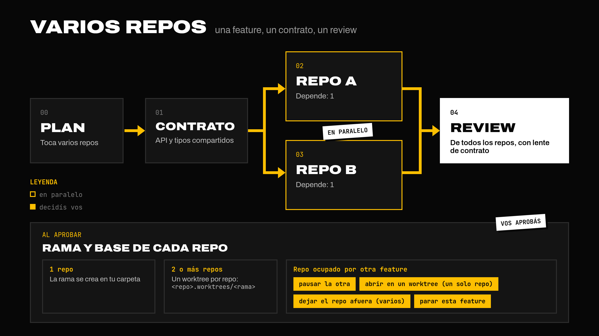

# Varios repos y worktrees

Un cambio que toca la API y el front a la vez es una sola feature, con un plan y una review; y varias features pueden convivir en un mismo repo, cada una en su carpeta, sin pisarse.

## Para qué sirve

Dos casos que en el chat salen mal. El primero: el cambio cruza repos (la API expone un campo, el front lo consume), y si cada repo se hace por separado nadie verifica que los dos lados coincidan. El segundo: tenés una feature a medias en un repo y aparece otra urgente en el mismo; con una sola carpeta, o la dejás a medias o mezclás los cambios. nxy usa **worktrees de git** (una carpeta más del mismo repo, con su rama) para que cada feature tenga la suya, y nunca commitea ni pushea por vos.

## Qué ves



- **El plan** trae una sección `### Repos` con cada repo, su rol (api, web, lib compartida) y su ruta, y cada lote toca **un solo repo**. El primer lote suele ser el **contrato** (lo que comparten los repos) y el de cada repo declara `Depende de:` ese lote.
- **Al aprobar**, Claude te pregunta la rama (`¿en qué rama trabajamos?`, con sugerencias) y, por cada repo, la base de la que sale.
- **Después**, nxy te avisa qué hizo en cada repo (por ejemplo `api: worktree en <ruta> (rama feature/x, creada desde main). Para abrirlo: cd '<ruta>' && claude`).
- **La review** suma la lente de **contrato entre repos**, que compara lo que expone un lado con lo que consume el otro y cita ambos ([Review](review.md)).
- **En la TUI**, la pantalla Worktrees (`w` desde Inicio) lista las carpetas con su rama, la feature que las usa y su estado ([La TUI](tui.md)).

Y desde la terminal, `nxy feature list` (o `/nxy:worktree list`):

```console
$ nxy feature list
Worktrees de facturacion-api (1):
- facturacion-api [master] (principal, esta sesión)
    ~/facturacion-api
    limpio
Rama base por defecto: master
Bases para `new --base`: master
```

En el repo de ejemplo no hay features ni worktrees extra, así que ves sólo la carpeta principal: `Worktrees de facturacion-api (1)`, su rama, `(principal, esta sesión)`, que está `limpio`, la rama base por defecto y las bases que se pueden usar con `new --base`. Con features abiertas, debajo aparece `Features de nxy (N)`, cada una `activa` o `pausada`, con sus repos, ramas y carpetas.

## Qué significa

- **Un repo va de a un lote por vez; repos distintos, en paralelo** cuando no dependen entre sí. Por eso el contrato va primero y en su propio lote ([Plan y lotes](plan-y-lotes.md)).
- **Una feature sin terminar por carpeta.** Cada feature toma («sostiene») los checkouts de sus repos mientras corre. Si el plan toca un repo que ya tiene otra feature, nxy no sigue: te pregunta **«repo ocupado — ¿qué hacemos?»**:

| Opción | Qué pasa |
| --- | --- |
| **Pausar la feature `<id>`** (recomendada) | La otra queda pausada, libera su repo y seguís con el plan; la retomás después |
| **Abrir en un worktree** | Sólo si el plan es de un repo: trabaja en `<repo>.worktrees/<rama>` y deja la carpeta ocupada como está |
| **Sacar `<repo>` del plan** | Sólo si hay varios repos y no todos están ocupados: nxy vuelve a planificar sin ese repo |
| **Parar esta feature** | Cierra la feature sin tocar nada |

- **Cuándo hay worktrees.** Con un solo repo, la rama se crea en tu carpeta (`git switch -c <rama> <base>`, o pasa a la rama si ya existe). Con dos o más repos, o si elegiste **Abrir en un worktree**, nxy crea un worktree por repo en `<repo>.worktrees/<nombre de la rama>`, al lado de la carpeta del repo (sin el `feature/` y con `_` en vez de espacios y símbolos). La rama que ya está abierta en otro worktree, o una carpeta que ya existe, se rechazan con el mensaje de git.
- **Editar el original se rechaza.** Si la feature trabaja en un worktree y el implementer intenta editar el checkout original, el hook responde `nxy: feature <id> works in a worktree — edit in <worktree>`, y Claude edita ahí.
- **Un repo fuera del plan.** Si un implementer edita un archivo de otro repo git, nxy lo suma a la feature una sola vez, como «sin declarar», y avisa (`<repo> is a repo outside the plan; added to the feature as undeclared`).
- **Un worktree nuevo no trae dependencias** (`node_modules`, build). nxy avisa cuando falta `node_modules` y **no instala nada**: el primer `Accept:` puede fallar hasta que lo hagas vos.
- **Pausar libera los checkouts.** `pause --feature` deja una marca (unos 100 bytes en `.nxy/local` del worktree), no escribe ningún handoff ni toca git. Otra feature puede usar el repo, y `resume --feature` los toma de nuevo (si uno está ocupado, te dice qué feature lo tiene).
- **Huérfano**: un worktree de un repo con feature abierta que ninguna feature tiene tomado.

## Qué hacer

Abrí Claude Code en un repo, o en una carpeta padre que no es repo, y nombrá en el pedido los otros repos. Después es una feature común ([Una feature, paso a paso](feature.md)): leé el plan, contestá la rama y las bases al aprobar, y abrí cada worktree con el comando que nxy te muestra.

Para manejar los worktrees a mano, con `/nxy:worktree` en Claude Code o `nxy feature` en la terminal:

```
/nxy:worktree list
/nxy:worktree new --name nota-credito --base main
/nxy:worktree new --branch feature/otra-cosa
/nxy:worktree pause --feature F7K2
/nxy:worktree resume --feature F7K2
/nxy:worktree close --feature F7K2
```

- `new --name <n> --base <rama>` crea la rama `feature/<n>` (con `--issue 14`, `feature/#14_<n>`) desde una base local. `new --branch <b>` abre una rama local que ya existe y no está abierta en otro lado. Los dos imprimen `Listo: worktree creado en <ruta>` y el comando para abrirlo (`cd '<ruta>' && claude`).
- `close --path <worktree>` cierra ese worktree. `close` sin `--path`, o con `--feature <id>`, cierra todos los de una feature (la indicada, o la terminada o pausada de esta carpeta). **Rechaza una feature activa** («terminala, pausala o frenala con `nxy feature stop` antes de cerrar sus worktrees») y un worktree con cambios sin guardar: con `--force` lo cierra igual, y Claude te pregunta antes de usarlo. La **rama no se borra**.
- Al pausar, Claude te pregunta una vez, sin insistir, «¿Algo para la próxima sesión?»; si contestás, queda como una nota de esa carpeta ([Memoria](memoria.md)). Al cerrar un worktree se borran sus notas temporales.

nxy nunca hace `stash`, nunca fuerza nada por su cuenta y nunca commitea ni pushea: el diff, el commit y el PR de cada repo son tuyos.

## Comandos y config

| Comando | Qué hace |
| --- | --- |
| `nxy feature list` · `/nxy:worktree list` | Worktrees del repo, ramas, bases y features abiertas |
| `nxy feature new --name <n> --base <rama> [--issue <n>]` | Rama nueva en un worktree nuevo |
| `nxy feature new --branch <b>` | Un worktree para una rama que ya existe |
| `nxy feature pause\|resume --path <worktree>` | Marca o desmarca un worktree como pausado |
| `nxy feature pause\|resume --feature <id>` | Pausa o retoma una feature entera |
| `nxy feature close --path <worktree> [--force]` | Cierra un worktree |
| `nxy feature close [--feature <id>] [--force]` | Cierra todos los worktrees de una feature terminada o pausada |
| `nxy feature stop [--feature <id>]` | Termina una feature en cualquier punto |

`feature stop` no figura entre las acciones de `/nxy:worktree`: lo normal es correrlo desde la terminal. Los worktrees no tienen claves de config.

## Relacionados

- [Plan y lotes](plan-y-lotes.md): el lote de contrato y `Depende de:`.
- [Review](review.md): la lente de contrato entre repos.
- [Una feature, paso a paso](feature.md): dónde entra la pregunta de la rama.
- [La TUI](tui.md): la pantalla Worktrees.
- [Memoria](memoria.md): las notas al pausar.
